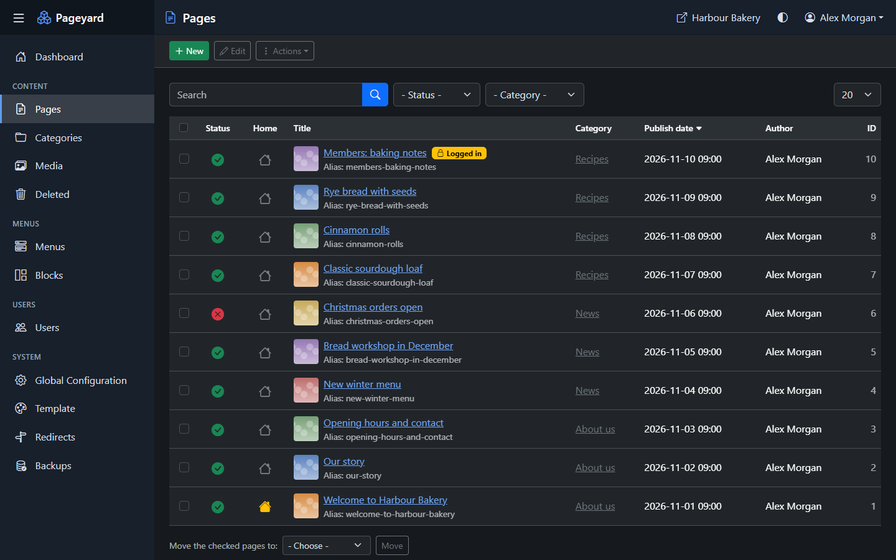
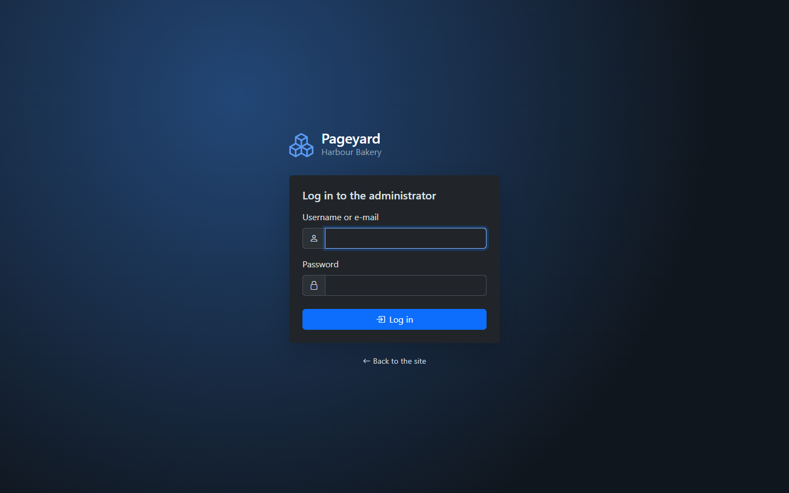
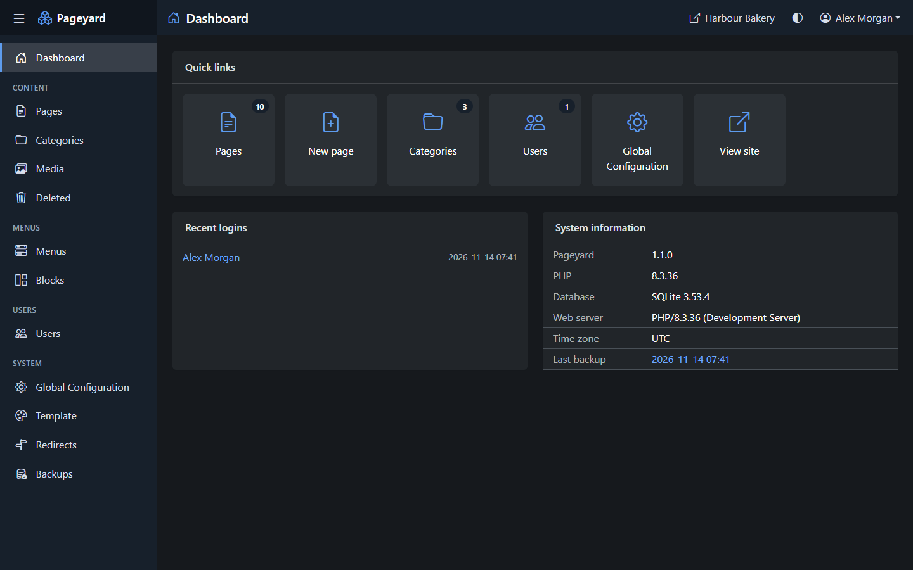
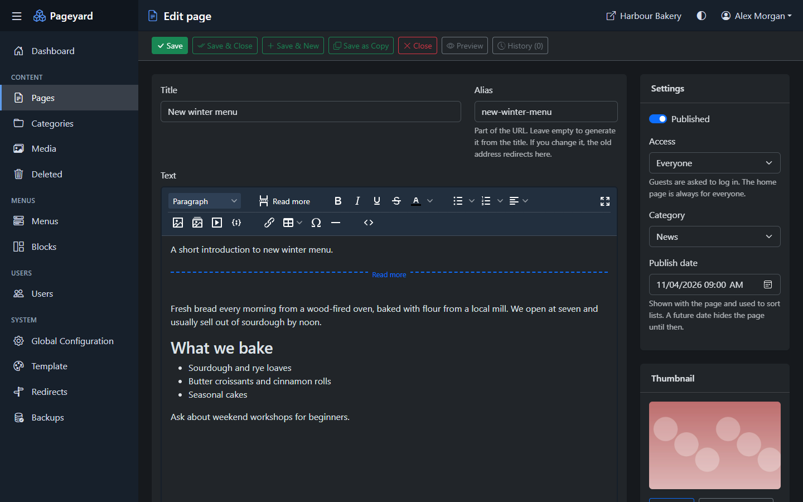
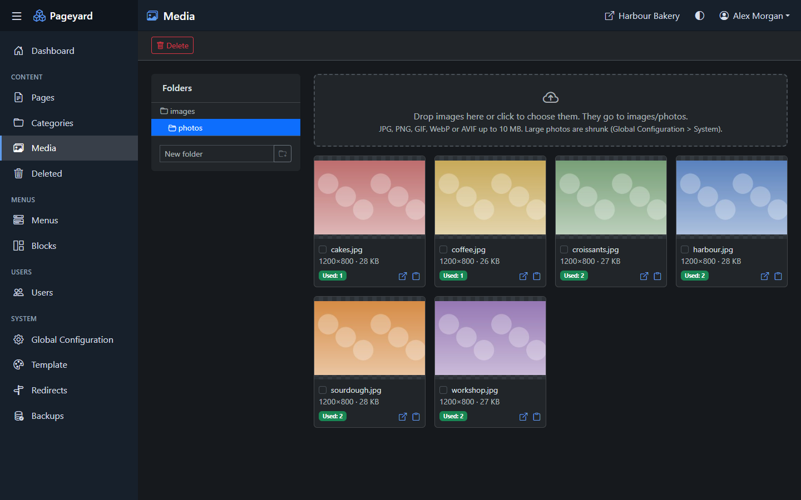

# Pageyard

A very light PHP CMS: pages, categories, menus, blocks, media library, a clean Bootstrap template, optional user
accounts on the site. SQLite by default, MySQL optional. No Composer, no frameworks.

## Screenshots

The administrator in dark mode (light mode is one click away). The site's look is up to you: the template is
plain Bootstrap with a few settings and custom CSS.

| | |
|---|---|
|  |  |
|  |  |

## Requirements

- PHP 8.3 or newer with `pdo_sqlite` (or `pdo_mysql`), `mbstring` and `fileinfo`.
- Recommended: `gd` (shrinking images, thumbnails), `zlib` (backups), `intl` (dates and aliases), `exif` (turning
  photos upright). Without them Pageyard works, with those features reduced.
- Apache with `mod_rewrite` (`.htaccess` is included), or IIS with URL Rewrite (`web.config` is included).
  On nginx, send unknown paths to `index.php` and deny `core`, `data`, `language`, `scripts`, `tests`,
  `configuration.php` yourself.

## Installing

1. Unpack the zip and put the contents of the `pageyard-<version>` folder in the web folder, the site root or a
   subfolder. Keep the hidden `.htaccess` files.
2. Open the site in a browser. The installer starts by itself and checks the requirements.
3. The folder, `data/` and `images/` must be writable by PHP.

After installing, the administrator is at `/administrator/`.

## User accounts on the site

Off by default. Global Configuration > Users switches on logging in on the site and, separately, registration
(which needs e-mail, Global Configuration > E-mail). Add a block of the type "User" to show the links. Pages,
categories, menu items and blocks can then be for logged-in users only (or, menu items and blocks, for guests only).
Only administrators use the back end.

## Lost password

With e-mail set up (Global Configuration > E-mail), the login page offers a link. Otherwise, from the site's
folder on the server:

    php core/cli/reset-password.php                  # lists the users
    php core/cli/reset-password.php admin            # sets a random password and prints it

## Restoring a backup

System > Backups has a Restore button; the current state is saved first. If the administrator won't open:

    php core/cli/restore-backup.php                  # lists the backups
    php core/cli/restore-backup.php <file name>      # restores one

Backups hold the database only (SQLite), not `images/`.

## Updating

Replace the program files with the new version, but keep `configuration.php`, `data/`, `images/`,
`templates/custom/` and your own files in `scripts/`. The database is updated on the next visit; with SQLite a backup is made first
(System > Backups).
